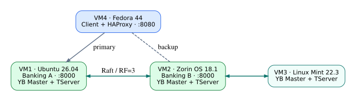
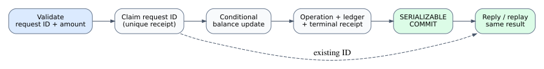
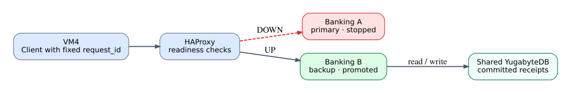
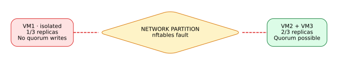

# Architecture

Two independent **stateless API instances** share one three-node YugabyteDB cluster. HAProxy routes to Banking A and switches to backup Banking B if A is unavailable. The application has no leader-election mechanism.

| Layer | Code | Responsibility |
| --- | --- | --- |
| API | `src/banking/api/` | Validation, routes, errors, health and logs |
| Application | `src/banking/application/` | Transactions and retry policy |
| Domain | `src/banking/domain/` | Rules, results and business errors |
| Database | `src/banking/infrastructure/` | SQLAlchemy models and YSQL connection |
| Operations | `infra/`, `scripts/` | Services, proxy, setup and checks |

## Transaction flow

1. Validate the account, action, positive amount and UUID `request_id`.
2. Within a `SERIALIZABLE` transaction, read a previous receipt or create a new one.
3. Update the account using conditional SQL, preventing negative balances.
4. Insert the operation **before** its ledger entry; flush the parent to satisfy the foreign key. Commit balance, receipt, operation and ledger together.
5. Return success after commit. Reusing the same ID and payload returns the stored result; changing the payload produces a conflict.

Tables: `accounts`, `request_receipts`, `operations`, `ledger_entries`, `health_probes`. Amounts are integer minor units, not floating-point money.

## Availability and consistency

HAProxy uses readiness checks and does not retry financial POSTs. Database serialization errors can be retried in fresh transactions; **an unknown commit outcome must not be retried blindly**.

YugabyteDB uses an RF=3 quorum for replication. A minority partition should not acknowledge conflicting committed writes; that claim requires [live partition tests](experiments.md), not only local unit tests.
